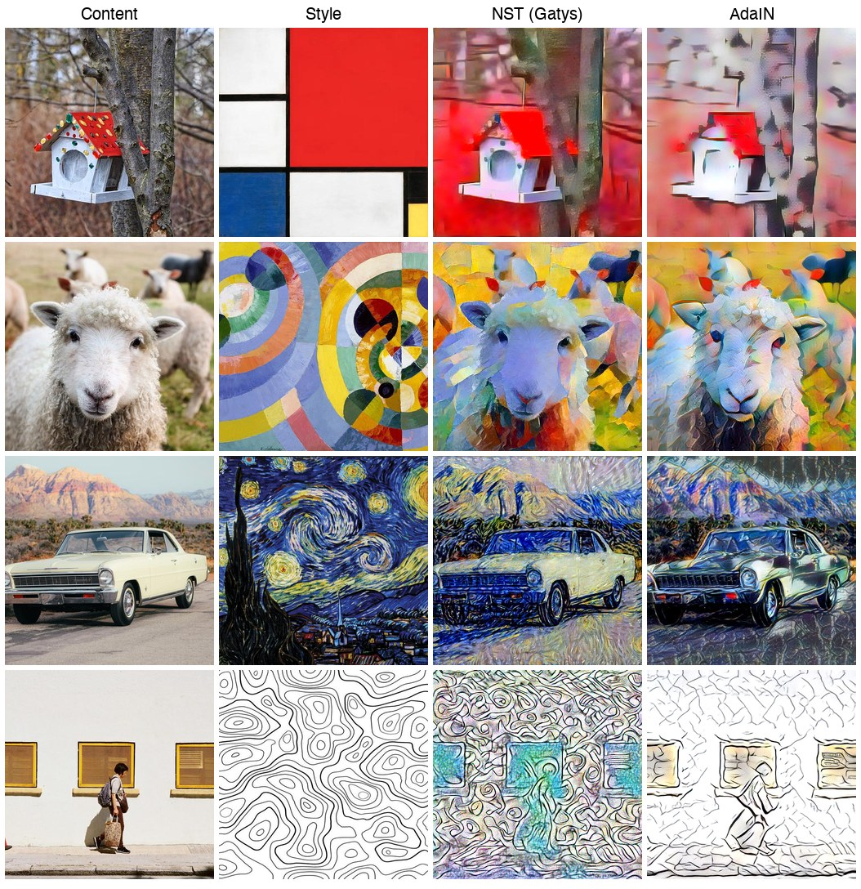
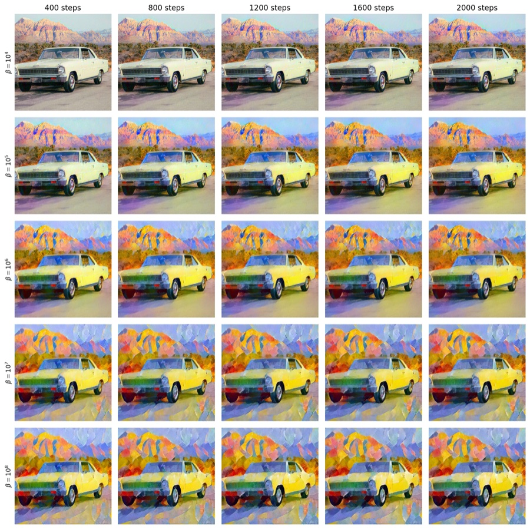
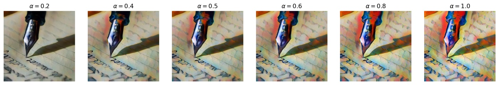

# Image Style Transfer

Uni project for *Introduction to Deep Learning* (2025W). We compared two ways of
painting a photo in the style of an artwork:

- **NST** (Gatys et al.): start from the photo and optimise its pixels with L-BFGS
  against a VGG19 content loss + Gram-matrix style loss. Slow, but the results look good.
- **AdaIN** (Huang & Belongie): match the mean/std of the VGG features to the style
  image and decode them. One forward pass, with a slider (`alpha`) for how much
  style you want.



## What else we tried

In NST, the style weight β decides how strong the style gets. The number of
optimisation steps matters much less:



AdaIN style strength, α from 0.2 to 1.0:



We also logged content/style losses for every content × style pair (30 photos × 10
styles) in [`out/metrics/`](out/metrics).

## Running it

```bash
pip install -r requirements.txt
cp config/config_template.yaml config/config.yaml   # fill in data/output paths
```

**NST** downloads VGG19 through torchvision on its own:

```bash
cd models && python nst_model.py
```

**AdaIN** uses the pretrained encoder/decoder from
[naoto0804/pytorch-AdaIN](https://github.com/naoto0804/pytorch-AdaIN/releases/tag/v0.0.0).
The standalone script downloads them to `models/weights/` the first time you run it:

```bash
python models/new_adain.py --content data/content/processed/img_5.jpg \
                           --style data/style/processed/style_1.jpg --alpha 0.8
```

## Layout

```
models/   nst_model.py, adain.py, new_adain.py (standalone CLI), eval.py (metrics)
data/     content + style images, resized to 512px
helpers/  make_grid.py for the comparison grids
out/      selected outputs + metrics CSVs
```

By Robin Rossner and Lizaveta Ausova.
